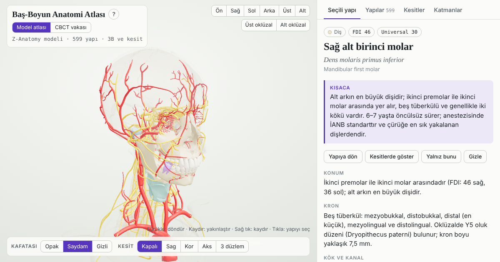

# Baş-Boyun Anatomi Atlası

Türkçe, etkileşimli 3B baş-boyun anatomi atlası. Tıp, diş hekimliği, fizyoterapi, ergoterapi ve sağlık bilimleri öğrencileri için hazırlanmıştır.

**Atlası açın:** https://atlas.mertocak.com/



## İçerik

- **Model atlası:** 599 yapıdan oluşan 3B baş-boyun modeli (Z-Anatomy). Kemikler, dişler, kaslar, damarlar, sinirler, lenf düğümleri, bezler, göz ve kulak katman katman açılıp kapatılabilir.
- **MR kesitleri:** Modelin aksiyel, koronal ve sagittal kesitleri; renkli etiket plakası ya da modele kayıtlı T1 ve T2 ağırlıklı MR görüntüsü (IXI veri seti).
- **CBCT vakası:** Gerçek, anonimleştirilmiş bir KIBT (CBCT) vakasında dişler, pulpa, kanallar ve mandibular kanal; panoramik, bukkolingual ve MPR kesitler (ToothFairy3 veri seti, 74 yapı).
- **Yapı kartları:** 324 Türkçe–Latince yapı kartı. Her kartta kısa bir özet ("Kısaca"), konum, komşuluklar, innervasyon ve beslenme, görev, kesitte tanıma ve klinik bilgiler bulunur. Latince terimler Terminologia Anatomica'ya (TA98, TA2) göredir; diş hekimliği terimleri diş hekimliğinde yerleşik biçimleriyle kullanılır.

Atlas tarayıcıda çalışır; kurulum gerekmez. Masaüstünde ve telefonda kullanılabilir.

## Metinlerin hazırlanması

Kart metinleri yapay zekâ desteğiyle (Claude, Anthropic) yazılmış ve birkaç turda gözden geçirilmiştir: Latince terimler Terminologia Anatomica'ya göre denetlenmiş, şüpheli bilimsel ayrıntılar standart kaynaklarla karşılaştırılmış, ikinci bir yapay zekâ modeliyle bağımsız kontrol yapılmış ve kartlar Türkçe bir ders kitabıyla karşılaştırılmıştır. Yöntem ve başvuru kaynakları atlasın "Veri, yöntem ve lisans" bölümündedir. Bu gözden geçirmeler uzman denetiminin yerine geçmez.

Atlas eğitim amaçlıdır; tanı ve tedavi kararlarında kullanılamaz.

## Lisans

Atlas farklı lisanslara sahip parçalardan oluşur:

| Parça | Lisans |
|---|---|
| Kart metinleri ve model atlasından türetilen yüzeyler | CC BY-SA 4.0 |
| MR görüntüleri (IXI) | CC BY-SA 3.0 |
| CBCT vakası ve ondan türetilen yüzeyler (ToothFairy3) | CC BY-NC-SA 4.0 (yalnızca ticari olmayan kullanım) |
| Sayfanın kodu | MIT |

Ayrıntılar, kaynak veri setleri ve istenen atıflar [LISANSLAR.md](LISANSLAR.md) dosyasındadır.

## Atıf

Atlası bir çalışmada kullanırsanız lütfen atıf yapın (bkz. [CITATION.cff](CITATION.cff)):

> Ocak M. Baş-Boyun Anatomi Atlası (Sürüm 1.0). 2026. https://github.com/mertuil/bas-boyun-anatomi-atlasi

CBCT vakasını kullanan yayınlar ayrıca ToothFairy3 için istenen çalışmalara atıf yapmalıdır (LISANSLAR.md).

## Geri bildirim

Hata ve önerilerinizi bu deponun [Issues](https://github.com/mertuil/bas-boyun-anatomi-atlasi/issues) bölümünden iletebilirsiniz.

## Yerel olarak açmak

Sayfa, model ve görüntü dosyalarını sunucudan yüklediği için doğrudan dosya olarak açıldığında çalışmaz. Depoyu indirdikten sonra klasörde basit bir sunucu başlatın:

```
python3 -m http.server 8000
```

ve tarayıcıda `http://localhost:8000` adresini açın.

## Hazırlayan

Doç. Dr. Mert Ocak · Ankara Üniversitesi Diş Hekimliği Fakültesi · [mertocak.com](https://mertocak.com) · ORCID [0000-0001-6832-6208](https://orcid.org/0000-0001-6832-6208)

---

## English

**Head and Neck Anatomy Atlas** — an interactive 3D atlas of the head and neck in Turkish, with Latin (Terminologia Anatomica) terms. It combines a 599-structure 3D model (Z-Anatomy) with model-registered MR sections (IXI), a real, anonymised CBCT case (ToothFairy3) and 324 structure cards. It runs in the browser on desktop and mobile. Card texts were written with AI assistance and reviewed in several rounds; the atlas is for education only and must not be used for diagnosis or treatment. Licences differ by component (CC BY-SA 4.0, CC BY-SA 3.0, CC BY-NC-SA 4.0 for the CBCT case, MIT for the code); see [LISANSLAR.md](LISANSLAR.md).
